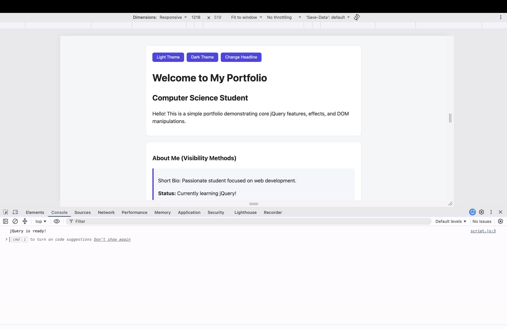
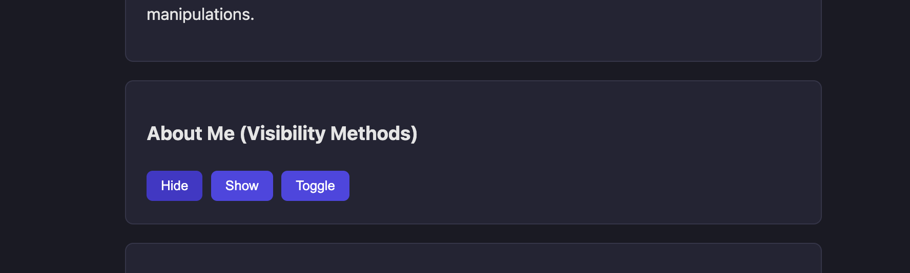
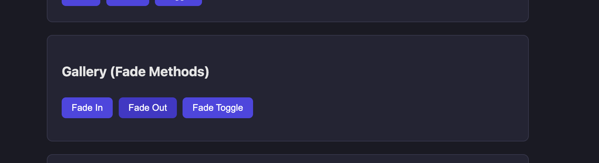
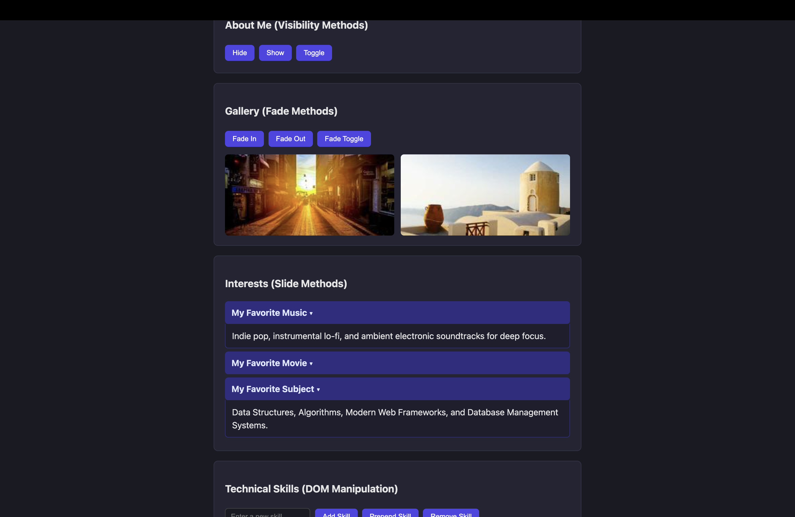
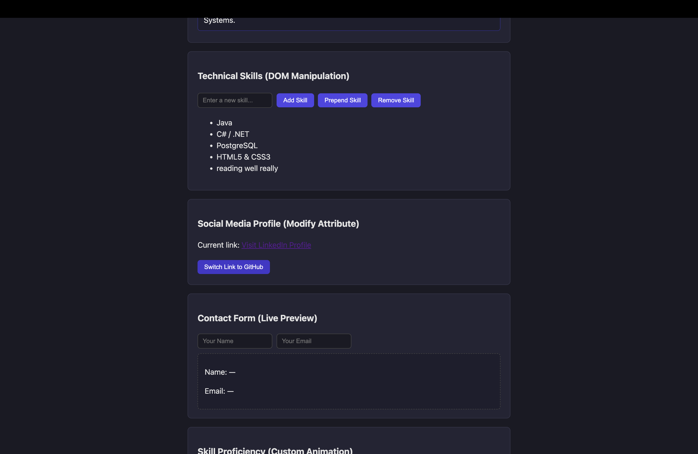
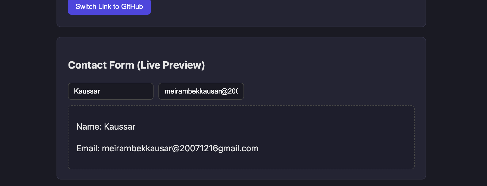
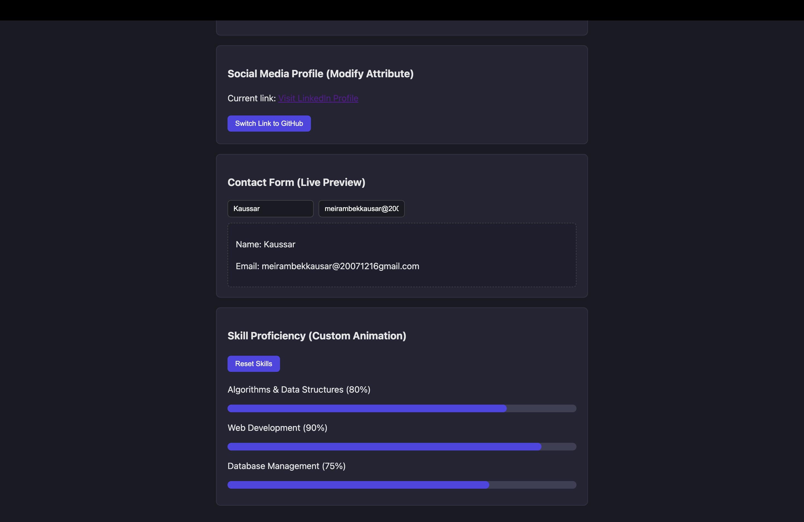

# Assignment #6: jQuery (Selectors, Effects, Animations)

* **Student Name:** Kaussar Meyrambekkyzy
* **Group:** IT-2513
* **GitHub Repository:** (https://github.com/meirambekkausar/web-assignment6.git)
* **GitHub Pages (Live Demo):** (https://meirambekkausar.github.io/web-assignment6/)

---

## Task Walkthrough & Screenshots

### Part 1. Getting Started with jQuery
* **Task 0. Setup:** Included jQuery via CDN and verified 'jQuery is ready!' in the browser console.
  
* **Task 1. Selectors & CSS:** Used tag, ID, and class selectors. Dynamically updated the headline using '.text()' and '.css()'. Implemented theme toggling between light and dark modes.
  

### Part 2. jQuery Effects
* **Task 2. Visibility Methods:** Controlled bio and status visibility using '.hide()', '.show()', and '.toggle()'.
  
* **Task 3. Fade Methods:** Handled gallery image transitions using '.fadeIn()', '.fadeOut()', and '.fadeToggle()'.
  
* **Task 4. Slide Methods:** Created accordion panels that slide up and down using '.slideToggle()'.
  

### Part 3. DOM Manipulation with jQuery
* **Task 5. Add & Remove Elements:** Implemented '.append()', '.prepend()', and'.remove()' with input validation to prevent empty skill items.
  
* **Task 6. Modifying Attributes:** Dynamically modified the link's 'href' attribute and text between GitHub and LinkedIn using '.attr()'.
  
* **Task 7. Form Interaction:** Displayed live user input below the form fields using '.val()' and '.text()'.
  

### Part 4. Animations
* **Task 8. Basic Animation:** Built interactive progress bars that expand to target widths on the first click using '.animate()' and reset back to 0% on the second click.
  

---

## Summary of Work Process
In this assignment, fundamental jQuery techniques were implemented: selecting DOM nodes, modifying inline styles and attributes, handling user input events, applying built-in effect methods (show/hide, fade, slide), and creating custom width animations using '.animate()'.
